<div align="center">

# Nexonic Download Manager

**Free, open-source download manager for Mac, Windows, Linux, Android, iPhone and iPad: an alternative to Internet Download Manager (IDM).**

Download faster, pause and resume anytime, and save videos from YouTube, Instagram, Facebook, X (Twitter), TikTok and
1,000+ other sites in the best quality.

[](https://github.com/Shahrukhalid/nexonic-download-manager/releases/latest)


[](LICENSE)
[](https://shahrukhalid.github.io/nexonic-download-manager/)

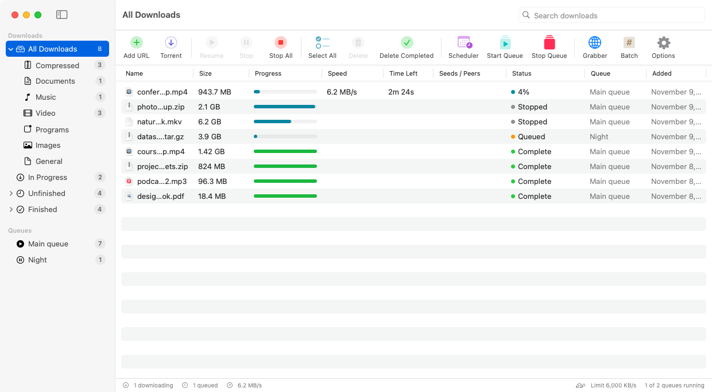

</div>

## Download

| System | File |
|---|---|
| **Mac** (macOS 13+, Apple silicon and Intel) | [NexonicDownloadManager-Mac.dmg](https://github.com/Shahrukhalid/nexonic-download-manager/releases/latest/download/NexonicDownloadManager-Mac.dmg) |
| **Windows** 10 / 11 | [NexonicDownloadManager-Windows-Setup.exe](https://github.com/Shahrukhalid/nexonic-download-manager/releases/latest/download/NexonicDownloadManager-Windows-Setup.exe) |
| Windows, no install | [NexonicDownloadManager-Windows-Portable.zip](https://github.com/Shahrukhalid/nexonic-download-manager/releases/latest/download/NexonicDownloadManager-Windows-Portable.zip) |
| **Linux**, any distribution (64-bit) | [NexonicDownloadManager-Linux-x86_64.AppImage](https://github.com/Shahrukhalid/nexonic-download-manager/releases/latest/download/NexonicDownloadManager-Linux-x86_64.AppImage) |
| Linux on ARM (64-bit) | [NexonicDownloadManager-Linux-aarch64.AppImage](https://github.com/Shahrukhalid/nexonic-download-manager/releases/latest/download/NexonicDownloadManager-Linux-aarch64.AppImage) |
| Ubuntu, Debian, Mint, Pop!_OS (.deb) and Fedora, openSUSE (.rpm) | [All Linux files](https://github.com/Shahrukhalid/nexonic-download-manager/releases/latest) · [Linux guide](docs/LINUX.md) |
| **Android** 10+ (phones and tablets) | [NexonicDownloadManager-Android.apk](https://github.com/Shahrukhalid/nexonic-download-manager/releases/latest/download/NexonicDownloadManager-Android.apk) |
| Android, older 32-bit phones | [NexonicDownloadManager-Android-32bit.apk](https://github.com/Shahrukhalid/nexonic-download-manager/releases/latest/download/NexonicDownloadManager-Android-32bit.apk) |
| Chrome, Edge, Brave, Opera extension | [NexonicExtension-Chrome.zip](https://github.com/Shahrukhalid/nexonic-download-manager/releases/latest/download/NexonicExtension-Chrome.zip) |
| Firefox add-on | [NexonicAddon-Firefox.xpi](https://github.com/Shahrukhalid/nexonic-download-manager/releases/latest/download/NexonicAddon-Firefox.xpi) |

Everything is included. Nothing else to install.

Windows with [Scoop](https://scoop.sh): `scoop bucket add nexonic https://github.com/Shahrukhalid/nexonic-download-manager` then
`scoop install nexonic-download-manager`. More package managers: [docs/PACKAGES.md](docs/PACKAGES.md).

> **Mac users:** the easiest way is one command in Terminal. It installs or updates the app and opens it without the
> "Apple could not verify" message:
>
> ```bash
> curl -fsSL https://shahrukhalid.github.io/nexonic-download-manager/install.sh | bash
> ```
>
> Prefer the `.dmg`? That works too: macOS asks once (System Settings → Privacy & Security → **Open Anyway**), and
> never again for that version.

## Install

**Mac, quickest:** paste this into Terminal. It installs (or updates) the app in Applications and opens it, with no
security warning:

```bash
curl -fsSL https://shahrukhalid.github.io/nexonic-download-manager/install.sh | bash
```

**Mac, from the disk image**

1. Open the `.dmg`, read the Terms of Use and click **Agree**.
2. Drag **Nexonic Download Manager** onto **Applications** (replace the old version if asked), then open it from
   Applications.
3. The first time, macOS says it *could not verify* the app. That's expected: the app is free and not sold through
   Apple. Allow it once (see [First launch on Mac](#first-launch-on-mac) below); after that it opens normally, and
   in-app updates never ask again.
4. If macOS says the app *is damaged and can't be opened*, open **Terminal** and run
   `xattr -cr "/Applications/Nexonic Download Manager.app"`, then open the app again.

**Windows**

1. Run the Setup file. If Windows says "Windows protected your PC", click **More info → Run anyway**.
2. Read the Terms of Use, choose **I accept the agreement** and follow the steps.

**Android**

1. Download `NexonicDownloadManager-Android.apk` on the phone and open it.
2. If Android asks, allow your browser or Files app to **install unknown apps**, then tap **Install**.
3. Open Nexonic and allow notifications, so downloads keep running with the screen off.
4. To download from Chrome or another browser: **Share → Download with Nexonic**. Or browse with Nexonic's built-in browser.

Updates install over the old version; your downloads list is kept.

**iPhone and iPad** (in testing, not on the App Store yet)

Install it with Xcode on your own device (free Apple ID): see [ios/README.md](ios/README.md). Then set up the one-tap
download once:

| | |
|---|---|
| 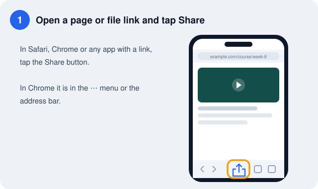 | 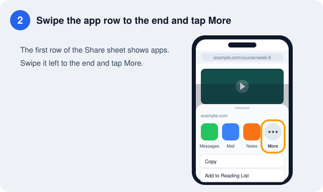 |
| **1. Tap Share** on a page or file link in Safari, Chrome or any app. | **2. Swipe the app row to the end** and tap **More**. |
| 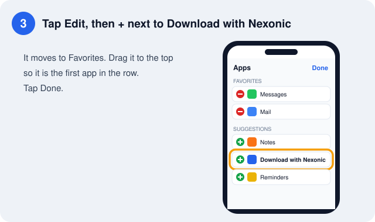 | 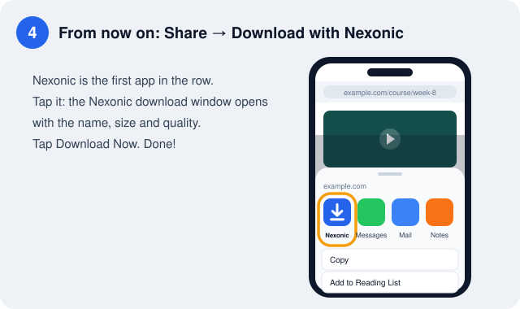 |
| **3. Tap Edit, then +** next to **Download with Nexonic**, and drag it to the top. | **4. Share → Download with Nexonic**, pick the quality, tap **Download Now**. |

This works as soon as the app is installed.

Files go to **Files › On My iPhone/iPad › Nexonic**. The same guide is in the app: Settings → Set Up Download Shortcut.

**Browser** (open the app once first):

- **Chrome, Edge, Brave, Opera:** unzip the extension, open the browser's extensions page, turn on **Developer mode**,
  click **Load unpacked** and pick the folder.
- **Firefox:** drag the `.xpi` onto Firefox. If Firefox says the add-on "has not been verified", that release's add-on
  isn't signed by Mozilla yet; for now open `about:debugging#/runtime/this-firefox` → **Load Temporary Add-on…** and
  pick the `.xpi` (it stays until Firefox restarts).

Updating? Install the new version over the old one; your downloads and settings are kept. If the Dock or Start menu
still shows the old icon, quit the app and open it again (on Mac, restarting the computer refreshes the icon cache).


### First launch on Mac

macOS shows a warning the first time you open an app that isn't sold through Apple. Allow it once:

1. **Open the app. When macOS says it was *Not Opened*, click Done** (not *Move to Bin*).

   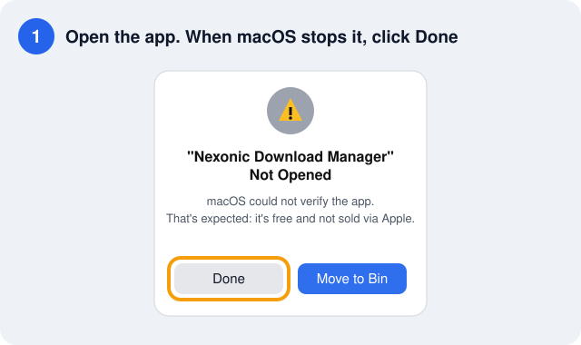

2. **Open System Settings → Privacy & Security**, scroll down to *Security* and click **Open Anyway** next to
   "Nexonic Download Manager was blocked".

   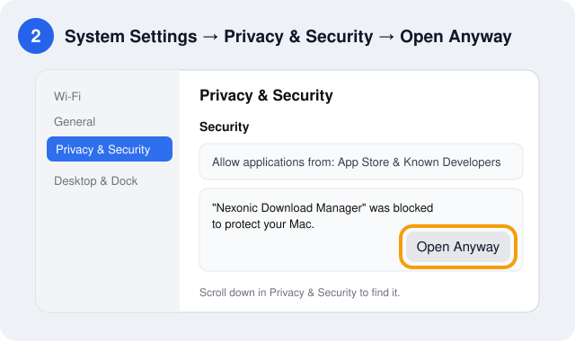

3. **Click Open Anyway** in the window that appears and enter your Mac password (or use Touch ID).

   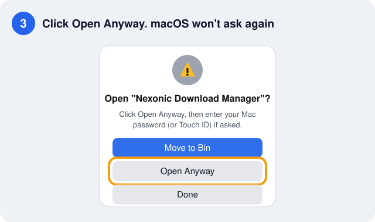

That's it: macOS won't ask again for this version, and updates installed from inside the app (**Update Now**) open
without any warning. On macOS 13–14 you can also right-click the app → **Open** → **Open**.

## Features

- **Fast downloads** that split each file into parts and download them at the same time.
- **Pause and resume**, even after a restart. Expired links can be refreshed without starting over.
- **Videos from YouTube, Instagram, Facebook, X, TikTok and 1,000+ sites**, in the quality you pick (the
  qualities each video offers are listed, up to 4K/8K) or sound only.
- **Download this video** button on any web page, and streamed video saved as one `.mp4`.
- **Browser integration** for Chrome, Edge, Brave, Opera and Firefox: click a download link (or the video button on a
  page) and a compact download window
  shows the name, size, category and folder (Start, Download Later or Cancel). If the app can't be reached, the browser
  simply keeps the download.
- **A progress window for every download** with speed, time left, a live speed graph, each connection's progress, and
  Pause/Resume/Cancel. Several downloads run side by side, each in its own window.
- **Scheduler and queues:** start at night, stop in the morning, sleep or shut down when done.
- **Batch downloads** (`img[001-100].jpg`), a **site grabber**, and **clipboard** detection.
- **Speed limits**, proxy, password-protected downloads and checksum checks.
- **Updates inside the app:** a new version shows up when you open the app, with what's new and Update Now, Remind
  Me Later or Skip This Version.
- **Same app on Mac, Windows and Linux**, light and dark mode, no account, no tracking.
- **Android app** with the same download and video engines: videos from YouTube, Facebook, Instagram, TikTok and
  1,000+ sites with quality choices, up to 32 connections, pause and resume, queues, scheduler, Wi-Fi only,
  speed limit, a built-in browser that catches downloads and lists the videos and files on a page, and
  **Share → Download with Nexonic** from Chrome or any app. Files are saved in *Download/Nexonic*.
  Details and Android limits: [android/README.md](android/README.md).
- **iPhone and iPad app** (in testing): **Share → Download with Nexonic** from Safari, Chrome or any app, a
  **Download with Nexonic** action for Shortcuts and Siri, background downloads, a built-in browser, and files in the
  Files app. Details and iOS limits: [ios/README.md](ios/README.md).

<p align="center">
  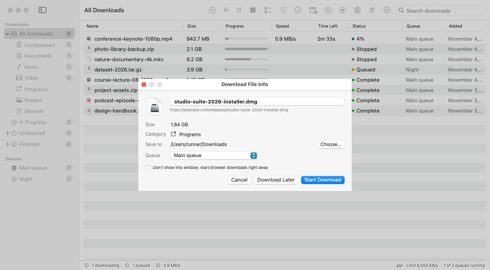
  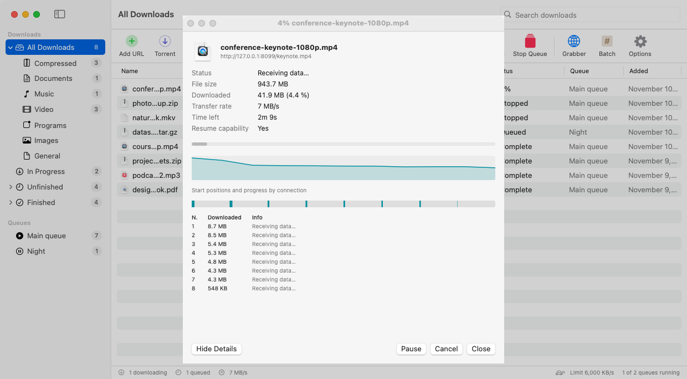
</p>

<p align="center">
  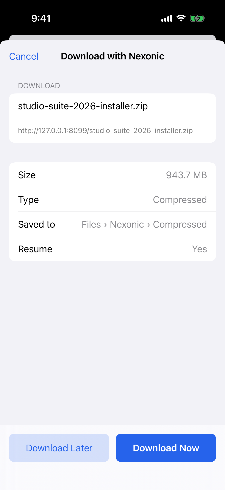
  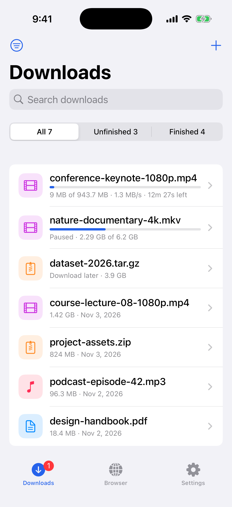
  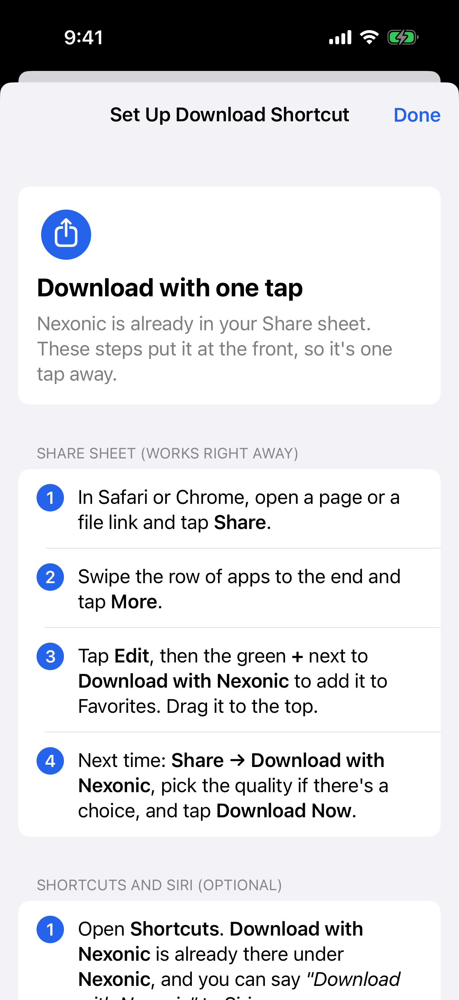
  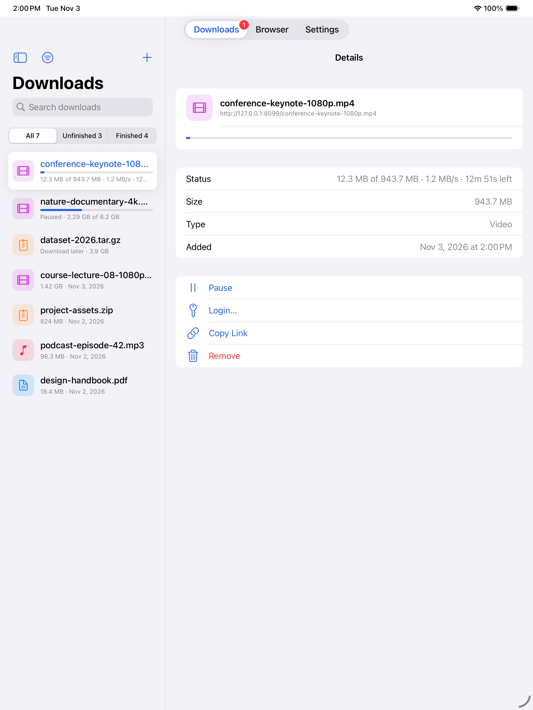
</p>

<p align="center">
  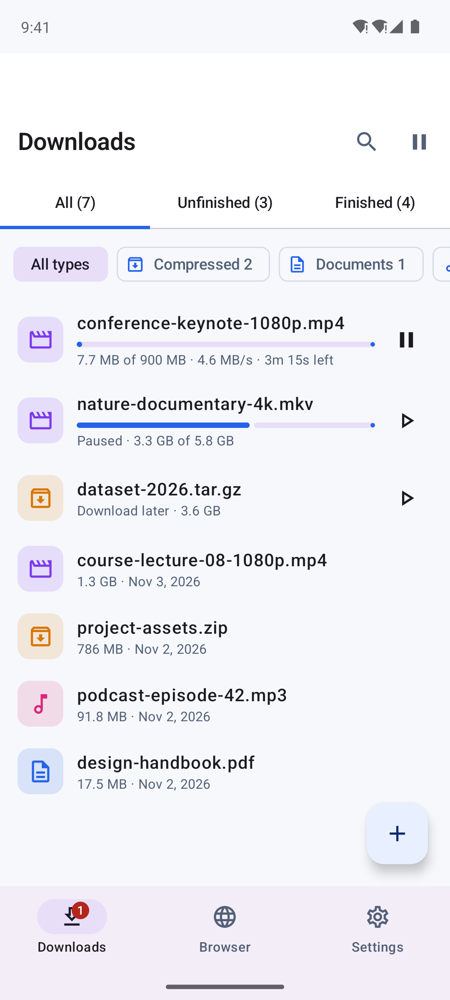
  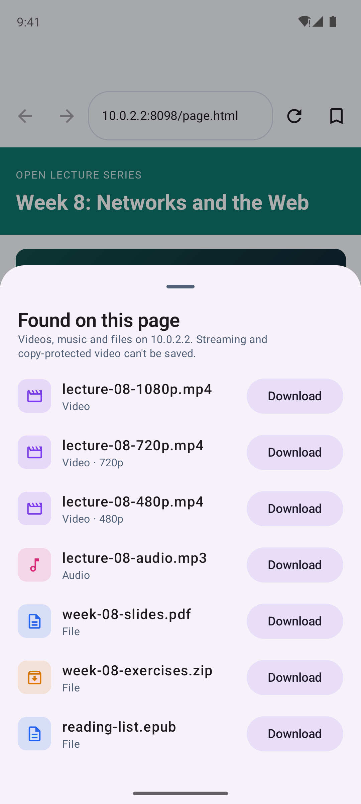
  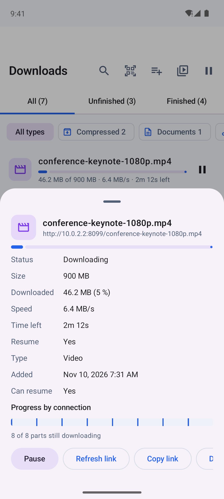
  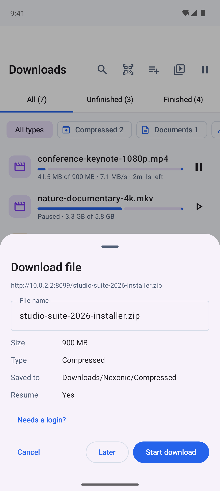
</p>

<p align="center">
  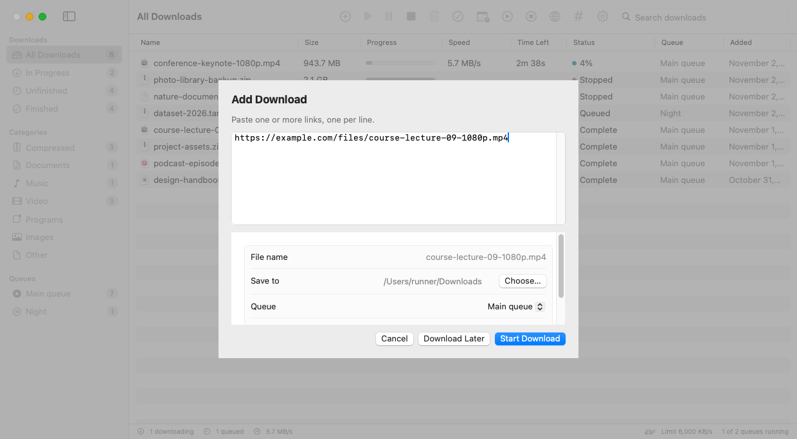
  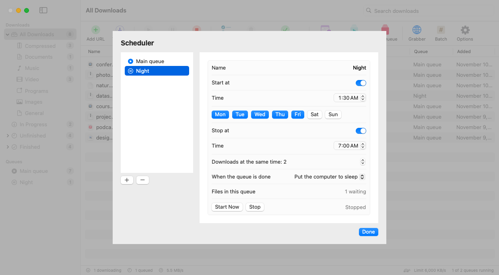
  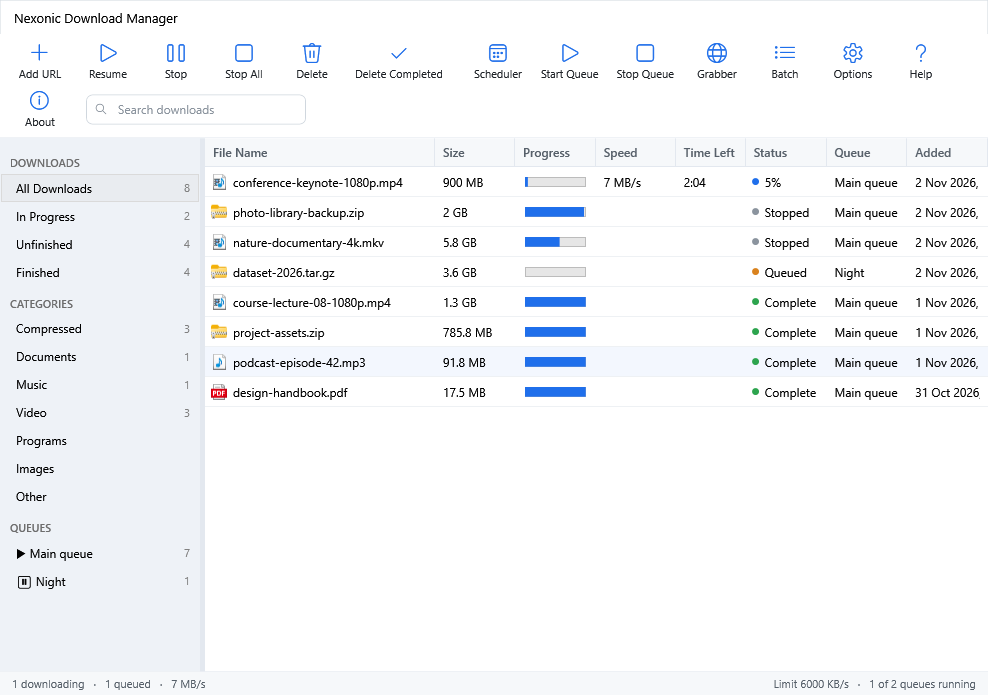
</p>

## How to use

| To | Do this |
|---|---|
| Download a link | **Add URL**, paste the link, **Start Download** |
| Save a YouTube / Instagram / Facebook / X / TikTok video | Point at the video → **Download this video**, or paste its link into **Add URL** |
| Download from a website | Click the download link in your browser; the app takes over |
| Download at night | **Scheduler** → **New Queue** → set the time → add downloads with **Download Later** |
| Continue an expired download | Right-click → **Refresh Link…** |

Command line: `ndm <link>` (Mac: **Settings → Browsers & Command Line → Install ndm Command**; Windows: added by the
installer). Run `ndm help` for options.

Copy-protected services (Netflix, Disney+, Prime Video, Spotify) are not supported. Only download videos you have the
right to save.

## Help and support

- **User guide:** [docs/HELP.md](docs/HELP.md), also built into the app: **Help → Nexonic Download Manager Help** (⌘?)
  on Mac, the **Help** button or **F1** on Windows.
- **About:** the About window shows your version, links and a **Check for Updates** button.
- **Report a problem:** [open an issue](https://github.com/Shahrukhalid/nexonic-download-manager/issues/new) with your
  system, the app version (from About) and the link if it is public.
- **What's new:** [CHANGELOG.md](CHANGELOG.md) and the [releases page](https://github.com/Shahrukhalid/nexonic-download-manager/releases).

## Privacy and terms

No account, no ads, no tracking: your downloads and settings stay on your computer. The app only connects to the
addresses you download from, and to GitHub to keep its video engine up to date and when you check for updates.
By installing you agree to the **[Terms of Use and License Agreement](TERMS.md)**: download only what you have the
right to, and respect copyright and each site's terms.

## Build from source

```bash
git clone https://github.com/Shahrukhalid/nexonic-download-manager.git && cd nexonic-download-manager
UNIVERSAL=0 bash scripts/build-app.sh     # Mac
pwsh windows/build.ps1                    # Windows (.NET 8 SDK, Inno Setup 6)
bash linux/packaging/build.sh x64 FFMPEG_DIR TOOLS_DIR   # Linux AppImage, .deb, .rpm (see docs/LINUX.md)
gradle -p android assembleDebug           # Android (JDK 17, Android SDK)
cd ios && NDM_VERSION=$(cat ../VERSION) xcodegen   # iPhone/iPad (Xcode 16, XcodeGen), then open Nexonic.xcodeproj
```

## License

Licensed under either of the [MIT License](LICENSE-MIT) or the [Apache License 2.0](LICENSE-APACHE), at your option.
© 2026 Shahrukh Khalid. Not affiliated with Internet Download Manager or any of the sites mentioned;
their names belong to their owners.

Unless you explicitly state otherwise, any contribution you submit for inclusion is dual licensed as above,
without any additional terms or conditions. Third-party components keep their own licenses
([notices](packaging/THIRD-PARTY-NOTICES.txt)).

Made by **[Shahrukh Khalid](https://www.shahrukhalid.com)** · [GitHub](https://github.com/Shahrukhalid). If this app
saves you time, please ⭐ star the repo so others can find it.
