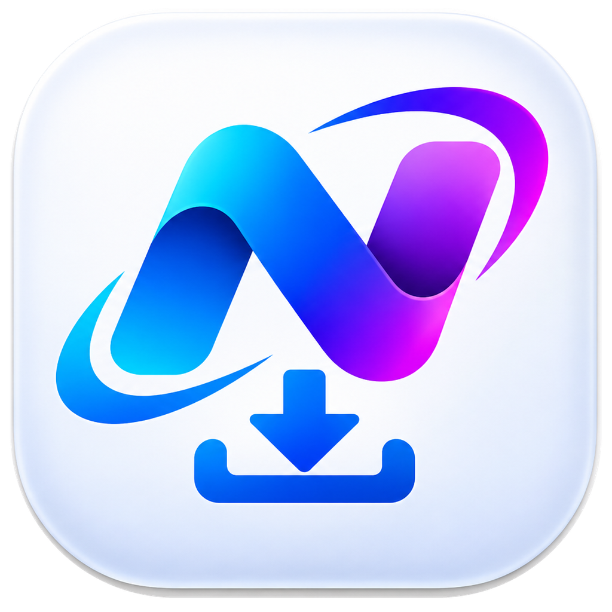
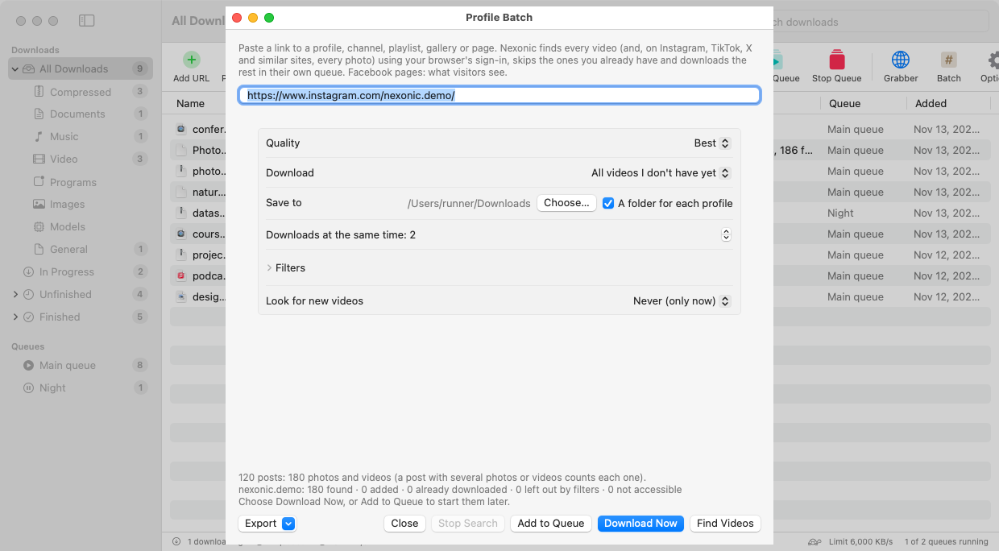
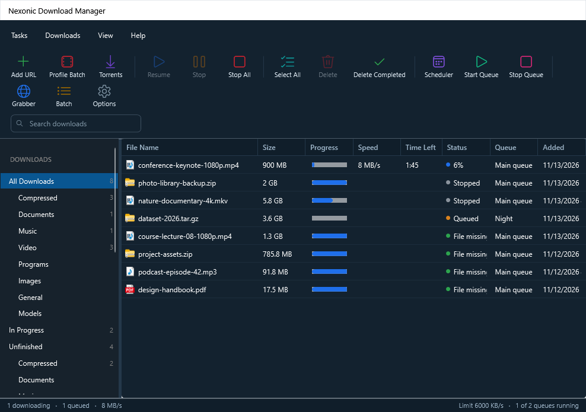
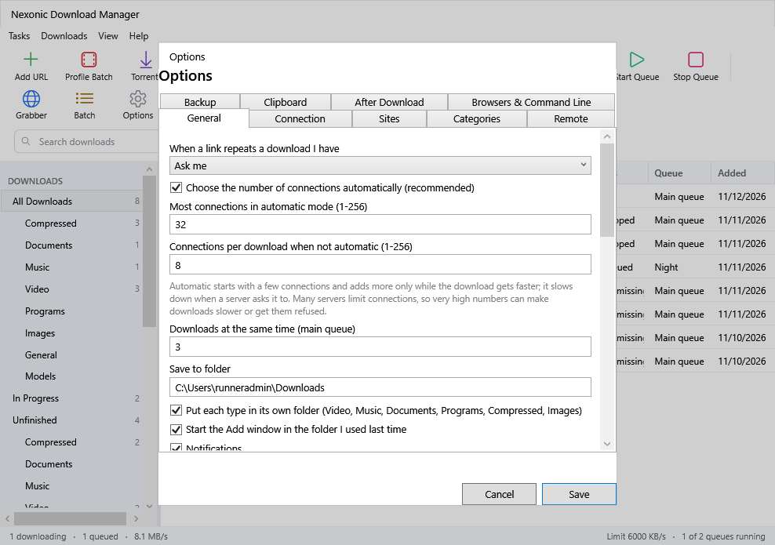

<div align="center">

# Nexonic Download Manager



**Free, open-source download manager for macOS, Windows, Linux and Android, with an iPhone and iPad build for testing.**

**Download every photo and video of an Instagram, TikTok or Facebook profile in one click.** An alternative to
Internet Download Manager (IDM) with up to 256 adaptive connections, resumable downloads, queues, scheduling,
a per-download speed limiter, BitTorrent and browser integration. Save videos from YouTube, Instagram, Facebook,
X, TikTok and 1,000+ sites on desktop and Android.

[](https://github.com/Shahrukhalid/nexonic-download-manager/releases/latest)
[](https://www.patreon.com/Shahrukhalid)


[](LICENSE)
[](https://www.bestpractices.dev/projects/16392)
[](https://shahrukhalid.github.io/nexonic-download-manager/)


</div>

## Download

| System | File |
|---|---|
| **Mac** (macOS 13+, Apple silicon and Intel) | [NexonicDownloadManager-Mac.dmg](https://github.com/Shahrukhalid/nexonic-download-manager/releases/latest/download/NexonicDownloadManager-Mac.dmg) |
| **Windows** 10 / 11 | [NexonicDownloadManager-Windows-Setup.exe](https://github.com/Shahrukhalid/nexonic-download-manager/releases/latest/download/NexonicDownloadManager-Windows-Setup.exe) |
| Windows, no install | [NexonicDownloadManager-Windows-Portable.zip](https://github.com/Shahrukhalid/nexonic-download-manager/releases/latest/download/NexonicDownloadManager-Windows-Portable.zip) |
| **Windows 11 on Arm** | [NexonicDownloadManager-Windows-ARM64-Setup.exe](https://github.com/Shahrukhalid/nexonic-download-manager/releases/latest/download/NexonicDownloadManager-Windows-ARM64-Setup.exe) · [portable](https://github.com/Shahrukhalid/nexonic-download-manager/releases/latest/download/NexonicDownloadManager-Windows-ARM64-Portable.zip) |
| **Linux**, x86-64 | [NexonicDownloadManager-Linux-x86_64.AppImage](https://github.com/Shahrukhalid/nexonic-download-manager/releases/latest/download/NexonicDownloadManager-Linux-x86_64.AppImage) |
| Linux on ARM (64-bit) | [NexonicDownloadManager-Linux-aarch64.AppImage](https://github.com/Shahrukhalid/nexonic-download-manager/releases/latest/download/NexonicDownloadManager-Linux-aarch64.AppImage) |
| Ubuntu, Debian, Mint, Pop!_OS (.deb) and Fedora, openSUSE (.rpm) | [All Linux files](https://github.com/Shahrukhalid/nexonic-download-manager/releases/latest) · [Linux guide](docs/LINUX.md) |
| **Android** 10+ (phones and tablets) | [NexonicDownloadManager-Android.apk](https://github.com/Shahrukhalid/nexonic-download-manager/releases/latest/download/NexonicDownloadManager-Android.apk) |
| Android, older 32-bit phones | [NexonicDownloadManager-Android-32bit.apk](https://github.com/Shahrukhalid/nexonic-download-manager/releases/latest/download/NexonicDownloadManager-Android-32bit.apk) |
| **iPhone and iPad** (iOS/iPadOS 17+, testing) | [Unsigned IPA](https://github.com/Shahrukhalid/nexonic-download-manager/releases/latest/download/NexonicDownloadManager-iOS-unsigned.ipa) · [Signing and installation guide](ios/README.md) |
| Chrome, Edge, Brave, Opera extension | [NexonicExtension-Chrome.zip](https://github.com/Shahrukhalid/nexonic-download-manager/releases/latest/download/NexonicExtension-Chrome.zip) |
| Firefox add-on | [NexonicAddon-Firefox.xpi](https://github.com/Shahrukhalid/nexonic-download-manager/releases/latest/download/NexonicAddon-Firefox.xpi) |

The file and torrent engines are included. On macOS, Windows and Linux, the app fetches the video engine from its
official release the first time you save a video. On macOS, Windows and Linux x64, whole-gallery downloads also fetch their engine on first use.
Torrents are off by default. See the [torrent guide](docs/TORRENTS.md).

Release assets come with SHA-256 checksums and GitHub build attestations. See [Verify your download](docs/VERIFY.md).

## Install

**Mac, Terminal installer:** this installs or updates the app in Applications and opens it. You can
[inspect the installer script](https://shahrukhalid.github.io/nexonic-download-manager/install.sh) before running it.

```bash
curl -fsSL https://shahrukhalid.github.io/nexonic-download-manager/install.sh | bash
```

**Mac, from the disk image**

1. Open the `.dmg`, read the Terms of Use and click **Agree**.
2. Drag **Nexonic Download Manager** onto **Applications** (replace the old version if asked), then open it from
   Applications.
3. If macOS says it could not verify the app, follow [First launch on Mac](#first-launch-on-mac) below.
4. If macOS says the app *is damaged and can't be opened*, open **Terminal** and run
   `xattr -cr "/Applications/Nexonic Download Manager.app"`, then open the app again.

**Package managers**

- **Homebrew (Mac):** `brew install --cask shahrukhalid/nexonic/nexonic-download-manager`.
- **Scoop (Windows x64 and Arm64):** run `scoop bucket add nexonic https://github.com/Shahrukhalid/nexonic-download-manager`
  and then `scoop install nexonic-download-manager`. Scoop uses the portable build.
- **WinGet (Windows x64 and Arm64):** the [catalog submission for v0.28.0](https://github.com/microsoft/winget-pkgs/pull/470114)
  tracks availability. See the [package manager guide](docs/PACKAGES.md).

**Linux**

Use the AppImage for your architecture or install the distribution's `.deb` or `.rpm`. See the
[Linux installation guide](docs/LINUX.md). AppImage updates download the changed parts when possible.

**Windows**

1. Run the Setup file for your architecture. If Windows says "Windows protected your PC", click **More info → Run anyway**.
2. Read the Terms of Use, choose **I accept the agreement** and follow the steps.

**Android**

1. Download `NexonicDownloadManager-Android.apk` on the phone and open it.
2. If Android asks, allow your browser or Files app to **install unknown apps**, then tap **Install**.
3. Open Nexonic and allow notifications, so downloads keep running with the screen off.
4. To download from Chrome or another browser: **Share → Download with Nexonic**. Or browse with Nexonic's built-in browser.

Updates install over the old version; your downloads list is kept.

**iPhone and iPad** (in testing, not on the App Store yet)

Build and run it from Xcode or sign the release IPA before installing. See the [iOS setup guide](ios/README.md).
Then use **Share → Download with Nexonic** from Safari, Chrome or another app. Files go to
**Files › On My iPhone/iPad › Nexonic**.

**Browser** (open the app once first):

- **Chrome, Edge, Brave, Opera:** unzip the extension, open the browser's extensions page, turn on **Developer mode**,
  click **Load unpacked** and pick the folder.
- **Firefox:** drag the `.xpi` onto Firefox. If Firefox says the add-on "has not been verified", that release's add-on
  isn't signed by Mozilla yet; for now open `about:debugging#/runtime/this-firefox` → **Load Temporary Add-on…** and
  pick the `.xpi` (it stays until Firefox restarts).

Updating? Install the new version over the old one; your downloads and settings are kept. If the Dock or Start menu
still shows the old icon, quit the app and open it again (on Mac, restarting the computer refreshes the icon cache).


### First launch on Mac

macOS may warn when you first open the current, unnotarized build. To open it:

1. **Open the app. When macOS says it was *Not Opened*, click Done** (not *Move to Bin*).

   

2. **Open System Settings → Privacy & Security**, scroll down to *Security* and click **Open Anyway** next to
   "Nexonic Download Manager was blocked".

   

3. **Click Open Anyway** in the window that appears and enter your Mac password (or use Touch ID).

   

On macOS 13–14 you can also right-click the app → **Open** → **Open**.

## Features

### Download all, in one click

Open an Instagram, TikTok or Facebook profile in your browser and click **Download all** in the Nexonic extension.

- **Everything, found in the background.** The Nexonic window opens with what the page shows and keeps finding
  the rest with your own browser sign-in: photos, videos and reels, at a pace the site accepts.
- **Your choice, then one click.** Choose the folder and quality, then **Download Now** or **Add to Queue**.
  Posts and files are counted separately, because one post can hold several photos or videos.
- **Keeps going.** Close the window and the search continues as a row in the downloads list. Click **Find Videos**
  later to add only what is new.
- Desktop apps (macOS, Windows, Linux x64). Facebook profiles are read in the background on Mac. Nexonic only sees
  what your account can see.

<p align="center">
  
</p>

### Downloads and scheduling

- **Adaptive downloads (desktop and Android).** Start with four connections and increase up to 256 while speed
  improves. Nexonic backs off when a server reports HTTP 429 or 503.
- **Mirrors and Metalink.** Add alternate sources or a `.meta4` file. Nexonic measures the sources, rejects a mirror
  serving a different file and verifies the finished file when a checksum is available.
- **Pause, resume and refresh links.** Resume after restarting the app, or replace an expired link and keep the data
  already downloaded. Import a browser's **Copy as cURL** command with its request details, or export a download as cURL.
- **Speed limiter and completion actions.** On Mac, each download's progress window has **Speed limiter** and
  **Options on completion** tabs: cap one download, then open the file, show the folder, sleep or shut down when it
  finishes. Torrents show seeds, peers, pieces, availability and ratio.
- **Queues, scheduling and speed limits.** Start downloads at set times, set time-of-day speed rules on desktop and
  Android, and set a data budget for capped connections. Desktop tools include batch patterns, clipboard detection,
  a site grabber and a link grabber that groups split archives.
- **Network controls.** Use a proxy, encrypted DNS over HTTPS or TLS, or select IPv4 or IPv6. The desktop server panel
  shows HTTP version, measured speed and server country from a local database.

### Browser, media and torrents

- **Desktop browser integration.** Chrome, Edge, Brave, Opera and Firefox can hand downloads to Nexonic. The download
  window lets you choose the destination and start now or add the file to a queue.
- **Video, audio and playlists.** Choose from the qualities the source offers, save audio only, or select items from
  supported playlists and channels. Where available, save subtitles and chapters and browse completed media in the
  Media Library. On macOS, Windows and Linux x64 you can also save entire galleries from supported sites. Windows and Linux can list and
  save selected images from a single page.
- **BitTorrent on desktop and mobile.** Open a magnet link or `.torrent` file, choose files and track peers, pieces and
  transfer speeds. The built-in engine checks each piece. Mobile background behavior varies by platform. See the
  [torrent guide](docs/TORRENTS.md).
- **RSS and debrid (Windows and Linux).** Preview feed rules, set size limits and keep one download per episode in
  your preferred quality. Debrid integration is optional and uses your own account.

### Desktop, server and mobile

- **Desktop controls.** See each download's speed, estimated time and progress. Use custom categories to route
  downloads by file type or site. Windows and Linux also offer custom colour schemes, fonts, quiet hours for sounds
  and saved column layouts.
- **Local remote management.** On Windows and Linux, enable **Options → Remote** and scan the pairing code to manage
  downloads from a phone on the same network. For headless use on a NAS or home server, see the
  [server and Docker guide](docs/SERVER.md).
- **Android.** Share links to Nexonic, find files or videos in its built-in browser, and use Wi-Fi-only transfers.
  Files are saved in `Download/Nexonic`. See the [Android guide](android/README.md).
- **iPhone and iPad (testing).** Use the Share extension, Shortcuts or the built-in browser. iOS manages background
  file transfers with one connection per file. See the [iOS guide](ios/README.md) for media and background limits.
- **Languages and updates.** The apps offer 110 languages, including 15 reviewed translations. Choose a language in
  Settings or Options. See [translations](docs/TRANSLATIONS.md) and check **About** for the installed version.

## Screenshots

<p align="center">
  
  
</p>

<p align="center">
  
  
  
</p>

<p align="center">
  
  
  
  
</p>

<p align="center">
  
  
  
</p>

<p align="center">
  
  
</p>

## How to use

| To | Do this |
|---|---|
| Download a link | **Add URL**, paste the link, **Start Download** |
| Save a YouTube / Instagram / Facebook / X / TikTok video | Point at the video → **Download this video**, or paste its link into **Add URL** |
| Download from a website | Click the download link in your browser; the app takes over |
| Download a whole profile | Open it in your browser → extension → **Download all** → choose folder and quality → **Download Now** |
| Download at night | **Scheduler** → **New Queue** → set the time → add downloads with **Download Later** |
| Continue an expired download | Right-click → **Refresh Link…** |

Use `ndm <link>` on the command line and run `ndm help` for options. On Mac, install the command from
**Settings → Browsers & Command Line → Install ndm Command**. The Windows installer adds it for you.

Copy-protected services (Netflix, Disney+, Prime Video, Spotify) are not supported. Only download videos you have the
right to save.

## Help and support

- **User guide:** [docs/HELP.md](docs/HELP.md), also built into the app: **Help → Nexonic Download Manager Help** (⌘?)
  on Mac, the **Help** button or **F1** on Windows.
- **About:** the About window shows your version, links and a **Check for Updates** button.
- **Report a problem:** [open an issue](https://github.com/Shahrukhalid/nexonic-download-manager/issues/new) with your
  system, the app version (from About) and the link if it is public.
- **What's new:** [CHANGELOG.md](CHANGELOG.md) and the [releases page](https://github.com/Shahrukhalid/nexonic-download-manager/releases).

## Support the project

Nexonic Download Manager is free and stays free for everyone. If it saves you time, you can support its development on
[Patreon](https://www.patreon.com/Shahrukhalid), star the repo, or tell a friend. Thank you!

## Privacy and terms

Nexonic requires no account and has no ads or tracking. Download history and settings stay on your device. The app
uses the network for your downloads, updates and optional features you enable, such as RSS feeds or a debrid provider.
By installing you agree to the **[Terms of Use and License Agreement](TERMS.md)**: download only what you have the
right to, and respect copyright and each site's terms.

**Code signing policy:** how release files are built and signed, who approves them, and the full privacy policy are in
[docs/CODE-SIGNING.md](docs/CODE-SIGNING.md). Free code signing for Windows is provided by SignPath.io, certificate by
SignPath Foundation (application in progress).

## Build from source

```bash
git clone https://github.com/Shahrukhalid/nexonic-download-manager.git && cd nexonic-download-manager
UNIVERSAL=0 bash scripts/build-app.sh     # Mac
pwsh windows/build.ps1                    # Windows (.NET 10 SDK, Inno Setup 6)
bash linux/packaging/build.sh x64 FFMPEG_DIR TOOLS_DIR   # Linux AppImage, .deb, .rpm (see docs/LINUX.md)
gradle -p android assembleDebug           # Android (JDK 17, Android SDK)
cd ios && NDM_VERSION=$(cat ../VERSION) xcodegen   # iPhone/iPad (Xcode 16, XcodeGen), then open Nexonic.xcodeproj
```

## License

Licensed under either of the [MIT License](LICENSE) or the [Apache License 2.0](LICENSE-APACHE), at your option
(SPDX: `MIT OR Apache-2.0`).
© 2026 Shahrukh Khalid. Not affiliated with Internet Download Manager or any of the sites mentioned;
their names belong to their owners.

Unless you explicitly state otherwise, any contribution you submit for inclusion is dual licensed as above,
without any additional terms or conditions. Third-party components keep their own licenses
([notices](packaging/THIRD-PARTY-NOTICES.txt)).
The Android app as a whole is distributed under GPL-3.0, because its video engine is GPL-3.0
([details](android/README.md#license)).

Made by **[Shahrukh Khalid](https://www.shahrukhalid.com)** · [GitHub](https://github.com/Shahrukhalid). If this app
saves you time, please ⭐ star the repo so others can find it.
